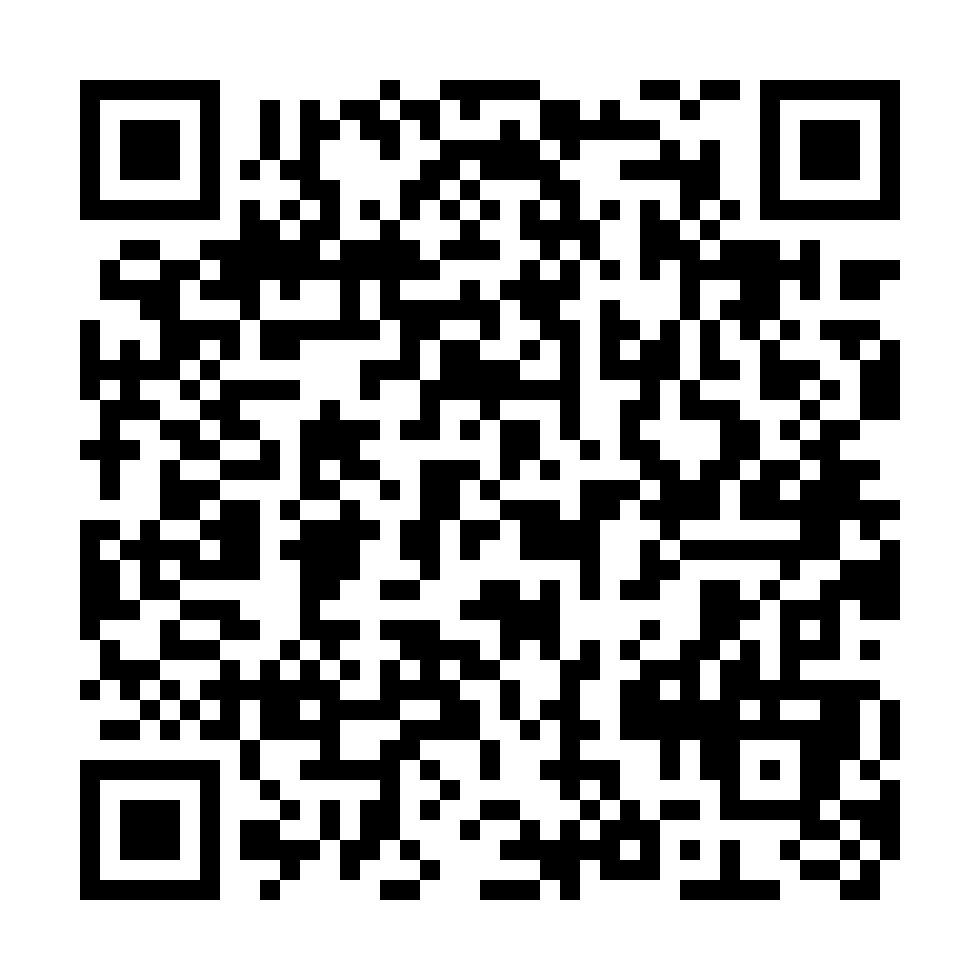

# ॐ-SYNTH (Om-Synth)
### The Sanskrit Acoustic Synthesizer & Multi-Script Phonology Studio

[](https://bitviper-cloud.github.io/Om-Script/)
[]()
[-blue?style=for-the-badge)]()
[](LICENSE)

**ॐ-SYNTH** is an interactive, browser-based phonology matrix and real-time speech synthesis engine engineered specifically for **ॐ-Script** and Pāṇinian Sanskrit acoustics.

It bridges ancient vocal-tract physiology with modern Web Audio DSP, multi-script transliteration, and the **Rule 8 (Sandhi-Free) Acoustic Protocol** established in *Sanskrit by Architecture*.

🔗 **Live Web Application:** [https://bitviper-cloud.github.io/Om-Script/](https://bitviper-cloud.github.io/Om-Script/)

<div align="center">
  
  <p><em>Scan with your smartphone to launch the studio instantly on iOS or Android</em></p>
</div>

---

## 🌟 Key Features

### Mode 1: The Pāṇinian Vocal Tract Matrix (The 5 Sthānas)
- **Anatomical Phonology Grid:** Organized strictly across the 5 vocal stations (*sthāna*: Kaṇṭhya $\to$ Tālavya $\to$ Mūrdhanya $\to$ Dantya $\to$ Oṣṭhya) plus compound throat-palatal and throat-lip stations.
- **Dynamic Script Toggle:** Easily toggle **Telugu (South Indic)** on/off with a single click. When turned off, **Devanāgarī** and **IAST** are prominently enlarged for focused Sanskrit and Modern Hindi vocabulary study.
- **Studio Audio Library:** 76 high-fidelity studio phoneme and vocabulary recordings bundled locally in `sounds/` for zero-latency playback.
- **DSP Auto-Silence Trimmer:** Real-time Web Audio API PCM amplitude gating strips encoder dead air down to exact vocal onset (<12ms latency).
- **Selected Phoneme Inspector HUD:**
  - Active glyphs in Devanāgarī, Telugu, and Roman IAST.
  - Sthāna classification, effort (*prayatna*), and color-coded anatomical cues.
  - Authentic Sanskrit example word with instant audio playback.
  - **Modern Hindi Cognate & English Meaning** showing direct linguistic evolution (e.g., क: *कमल / Lotus*, प: *फल / Fruit*, ह: *हाथ / Hand*).
- **Interactive Anatomical Vocal Tract SVG:** Clicking any phoneme highlights the tongue and resonance position on the anatomical cross-section.

### Mode 2: ॐ-Script Read-Aloud Studio (Karaoke Synthesizer)
- **Continuous ॐ-Script Speech Engine:** Parses any ॐ-Script sentence and recites it with natural, rhythmic cadence.
- **Dual Audio Flow Modes:**
  - **Buffered Stream (Continuous):** Pre-buffers and stitches morphemes for ultra-smooth recitation with sub-millisecond karaoke alignment.
  - **Step-by-Step Pacing:** Discrete word-by-word analysis with adjustable pause intervals.
- **Procedural Web Audio Breath Oscillators & Tibetan Bowls:**
  - `him`: 150ms respiratory breath intake / rhythmic reset.
  - `hūṃ`: 108Hz harmonic chest drone / clause boundary resonator.
  - `OM`: 432Hz / 136.1Hz Tibetan singing bowl physical modeling drone.
  - `॥`: 528Hz singing-bowl bell resolution.
- **Synchronous Multi-Script Karaoke HUD:** Highlights the active word in real time across 5 parallel visual ribbons:
  1. **ॐ-Script Blueprint** (Morpheme segmentation)
  2. **Devanāgarī Script** (Classical Sanskrit surface form)
  3. **Telugu Script** (South Indic unstacked form without *vattulu*)
  4. **Roman IAST** (Phonetic alignment)
  5. **Syntactic Kāraka Spine** (Subject [1.1], Object [2.1], Instrument [3.1], Verb chips)
  6. **Fluent English Bridge** (SVO natural sentence)
  7. **Modern Hindi Synthesis** (SOV natural sentence)
- **Pre-Loaded Canonical Presets:** Instant testing of sentences from Chapters 1 through 7 of *Sanskrit by Architecture*.

---

## 🚀 How to Run

### 1. Instant Web & Mobile Access
Visit: **[https://bitviper-cloud.github.io/Om-Script/](https://bitviper-cloud.github.io/Om-Script/)**  
Works out of the box in all modern browsers (Chrome, Edge, Safari, Firefox) on desktop and mobile.

### 2. Standalone Native Desktop App (Zero-Config)
To run locally without opening a standard browser tab:
```bash
python desktop_app.py
```
*Launches as a dedicated borderless desktop application via Microsoft Edge Native App Mode or PyWebView.*

### 3. Local Web Server (Offline Mode)
```bash
python serve.py
```
Then visit `http://localhost:8080/index.html`.

### 4. Install as a Desktop PWA
Open the URL in Microsoft Edge or Google Chrome, and click the **"Install ॐ-SYNTH"** icon in the URL bar to pin it to your Windows Taskbar/Start Menu as an offline progressive web app.

---

## 📁 Repository Structure

```text
Om-Script/
├── .nojekyll                 # Bypasses Jekyll on GitHub Pages for raw asset delivery
├── index.html                # Semantic HTML5 dual-mode application shell
├── style.css                 # Vanilla CSS design system with glassmorphism & dark theme
├── app.js                    # Dual-mode controller, DOM binding, and script toggle
├── phonology-data.js         # Pāṇinian phonological dataset, Hindi cognates & meanings
├── om-audio.js               # Web Audio API engine, DSP silence trimmer, & speech streamer
├── desktop_app.py            # Zero-dependency borderless desktop app launcher
├── serve.py                  # Local UTF-8 HTTP development daemon
├── manifest.json             # Progressive Web App (PWA) manifest
├── qr_om_synth_300dpi.png    # 300 DPI print-ready QR code for physical book editions
└── sounds/                   # 76 studio phoneme and vocabulary MP3 recordings
```

---

## 📜 Academic Reference & Citation

This companion application implements the formal linguistic specification and acoustic protocol defined in:

> **George, Timothy A. (2026).**  
> *Sanskrit Reborn: The Blueprint for a Universal Second Language — Sanskrit by Architecture.*  
> First Edition.
